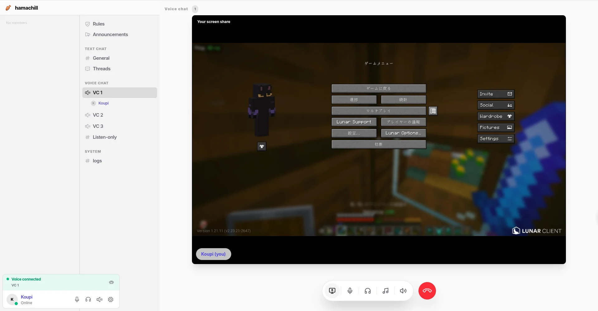
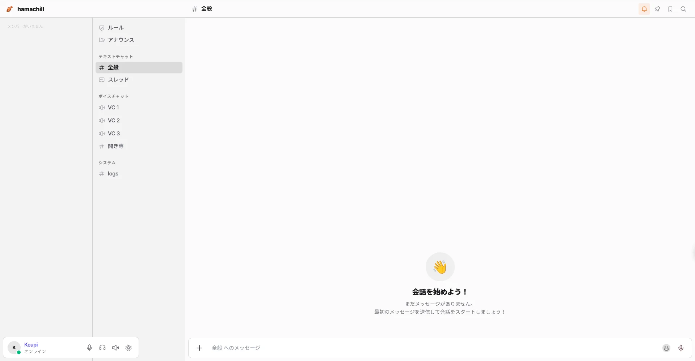
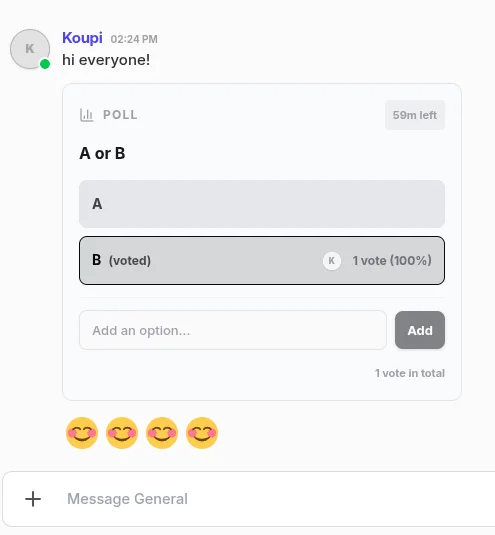

# hamachill

A small, self-hosted chat app for a group of friends: text channels, threads, DMs, voice chat with screen sharing, and a lot of little extras. It runs as a single Node.js server with a SQLite database and needs **no external APIs or services**.

## Screenshots



<p>
  
  
</p>

## Features

- Text channels (`#general`, `#announcements`, `#rules`, a listen-only text channel next to voice) and forum-style **threads**
- **Direct messages**, mentions, unread counts, read state
- **Voice chat** (3 rooms, WebRTC via a built-in PeerJS server), screen sharing, noise suppression, soundboard (built-in and per-user custom sounds)
- Replies, reactions, edits, pins, bookmarks, full-text search (with `from:`, `has:`, `mentions:`, `before:`, `after:`, `pinned:` filters)
- File, image and voice-message uploads, a drawing pad, spoilers, polls, feedback forms
- Custom emoji, stamps (stickers), Twemoji emoji (served locally)
- YouTube / Twitch link embeds
- Profiles with avatars, banners, colours and name styles; online / away / invisible presence; several themes
- Optional GIF search (KLIPY), hidden when no API key is set
- Admin tools: an admin-only `logs` channel (deletion log), posting in `#announcements` / `#rules`, deleting any message, unlimited custom emoji

Accounts are created by the server operator from the command line (`manage.js`); there is no public sign-up.

The UI is available in **English and Japanese**. The language follows the browser (`ja*` → Japanese, anything else → English) and can be changed in **Settings → Appearance → Language**. The account manager CLI (`manage.js`) follows the terminal's locale (`LANG`); force it with `HAMACHILL_LANG=en` or `ja`.

## Quick start (Docker)

```bash
cp .env.example .env
# Set JWT_SECRET (32+ random characters):
node -e "console.log(require('crypto').randomBytes(48).toString('hex'))"
# ...paste it into .env as JWT_SECRET=...

docker compose up -d --build

# Create the first account (it becomes admin when ADMIN_IDS is empty)
docker compose exec hamachill node manage.js add <accountId> <password> <displayName>
```

Open <http://localhost:3000> and log in.

All data (SQLite DB, uploads, soundboards, stamps) lives in the `hamachill-data` volume, mounted at `/data`.
To add stamps, put image files in `/data/stamps/<genre>/` (e.g. `docker compose cp ./my-stamps/. hamachill:/data/stamps/general/`).

## Without Docker

Requires Node.js 22.

```bash
npm ci                      # frontend dependencies
npm ci --prefix server      # server dependencies
cp .env.example .env        # then set JWT_SECRET (see above)
npm run build               # build the frontend into dist/
npm run admin               # interactive account manager (or: node server/manage.js add <id> <password> <name>)
npm start                   # http://localhost:3000
```

Data goes to `server/` by default (`server/db.db`, `server/uploads/`, `server/soundboards/`, `server/stumps/`); set `DATA_DIR` to move it.

For development with hot reload, run `npm run dev:all` (Vite on :5173, server on :3000).

`node server/manage.js help` lists all account commands (`list`, `add`, `passwd`, `make`, `remove`, `stats`, ...). See `server/README_ACCOUNT_MANAGEMENT.md`.

## Configuration (`.env`)

| Variable | Default | Description |
| --- | --- | --- |
| `JWT_SECRET` | — (**required**) | Secret for signing login tokens, 32+ characters. The server refuses to start without it. |
| `HOST` | `0.0.0.0` | Bind address. |
| `PORT` | `3000` | HTTP port (app, API, Socket.IO and PeerJS all share it). |
| `DATA_DIR` | `server/` (`/data` in Docker) | Where the SQLite DB, uploads, soundboards and stamps are stored. |
| `PUBLIC_ORIGIN` | empty | Public URL the app is served from, e.g. `https://chat.example.com`. Allowed for CORS / Socket.IO, and as a Vite dev host. `localhost` is always allowed. |
| `EXTRA_ORIGINS` | empty | More allowed origins, comma separated (e.g. `http://192.168.1.10:5173`). |
| `TRUST_PROXY` | empty | Set to `1` when running behind a reverse proxy (nginx, Caddy) so client IPs come from `X-Forwarded-For`. Leave empty when exposed directly. |
| `TRUST_CLOUDFLARE` | empty | Set to `1` only when all traffic comes through Cloudflare; uses `CF-Connecting-IP` for rate limiting. |
| `ADMIN_IDS` | empty | Admin account IDs, comma separated. **If empty, the first account created becomes the admin.** |
| `ICE_SERVERS` | empty | STUN/TURN servers for voice chat, as JSON (`[{"urls":"turn:turn.example.com:3478","username":"u","credential":"p"}]`) or comma-separated URLs (`stun:stun.example.com:3478`). **Empty = voice chat works on the same LAN only.** For calls over the internet, set a STUN server and, for strict NATs, a TURN server. |
| `KLIPY_API` | empty | KLIPY API key for GIF search. Empty hides the GIF tab. |
| `MAX_UPLOAD_MB` | `95` | Max attachment size in MB. Keep it under 100 behind Cloudflare. |
| `AUTH_RATE_LIMIT` | `5` | Auth requests allowed per IP per minute. |
| `LOGIN_RATE_LIMIT` | `10` | Login attempts allowed per account per 15 minutes. |
| `DEBUG` | empty | `1` for verbose logs. |

Voice settings (ICE servers), the GIF flag, the upload limit and your own admin status are served to the browser from `GET /api/config`.

## Exposing it with Cloudflare Tunnel (optional)

You can put the server on the internet without opening ports using [cloudflared](https://developers.cloudflare.com/cloudflare-one/connections/connect-networks/):

```bash
cloudflared tunnel login
cloudflared tunnel create hamachill
cloudflared tunnel route dns hamachill chat.example.com
cloudflared tunnel run --url http://localhost:3000 hamachill
```

Then set `PUBLIC_ORIGIN=https://chat.example.com` and `TRUST_CLOUDFLARE=1` in `.env` and restart. WebSockets (Socket.IO and PeerJS) work through the tunnel. Uploads default to 95 MB per file (`MAX_UPLOAD_MB`) to stay under Cloudflare's 100 MB request limit. For voice chat across networks, also set `ICE_SERVERS`.

## Translations

The UI strings live in `src/i18n/<lang>.json` (nested keys, e.g. `chat.typing`). The module in `src/i18n/index.js` is tiny and has no dependencies:

```js
import { t, formatDate, formatRelative } from '../i18n';

t('composer.placeholder', { name: channel.name });   // "{{name}}" placeholders
t('forum.threadCount', { count: 3 });                // plural forms: { "one": "...", "other": "..." } (Intl.PluralRules)
formatDate(msg.timestamp, { hour: '2-digit', minute: '2-digit' });
formatRelative(-5, 'minute');                        // "5 minutes ago"
```

Inside components you can also use `useT()` / `useI18n()` from `src/i18n/context.js` (`I18nProvider` wraps the app in `main.jsx`). The language is chosen once at startup (saved setting in `localStorage` → `navigator.language`); changing it saves the choice and reloads the page.

The server does not send translated text: HTTP errors carry a `code` (and `params`), translated on the client under `serverErrors.*`, and socket errors are codes as well. System messages (pins, poll results, the deletion log) are stored as `__SYS__{...}` JSON and rendered in each reader's language (`src/utils/systemMessages.js`).

### Adding a language

1. Copy `src/i18n/en.json` to `src/i18n/<code>.json` (e.g. `ko.json`) and translate the values. Keep the keys and the `{{placeholders}}`; plural values are objects keyed by `Intl.PluralRules` categories (`zero`, `one`, `two`, `few`, `many`, `other`; `other` is required).
2. In `src/i18n/index.js`, import the file, add it to `DICTIONARIES`, add `{ code, label }` to `LANGUAGES` (the label is shown in its own language), and extend `detectLanguage()` / `getLocaleTag()` if the browser language should pick it automatically.
3. Run `npm run i18n:check`. It reports keys missing from any locale, placeholders that don't exist in the Japanese source, and any Japanese text left in `src/` outside `src/i18n` (comments are ignored; a line can opt out with an `i18n-ignore` comment, used for kaomoji that are message content).

When you add UI text, add the key to every locale and run `npm run i18n:check`.

## Credits

- Made by **Koupi**.
- Emoji graphics: [Twemoji](https://github.com/jdecked/twemoji) by Twitter, Inc. and other contributors, licensed under [CC-BY 4.0](https://creativecommons.org/licenses/by/4.0/). SVGs from the [`@twemoji/svg`](https://www.npmjs.com/package/@twemoji/svg) package (MIT), copied to `public/twemoji/` at build time.
- Fonts: [Inter](https://rsms.me/inter/) and [Noto Sans JP](https://fonts.google.com/noto/specimen/Noto+Sans+JP) (SIL Open Font License 1.1), bundled via [Fontsource](https://fontsource.org/).
- Icons: [Phosphor Icons](https://phosphoricons.com/) and [Lucide](https://lucide.dev/).

## License

[MIT](LICENSE) © 2026 Koupi

---

## 日本語

友だち同士で使う、セルフホスト型のチャットアプリです。テキストチャンネル・スレッド・DM・画面共有つきの通話などがあり、Node.js サーバー 1 つと SQLite だけで動きます（外部 API・外部サービス不要）。

1. `.env.example` を `.env` にコピーして `JWT_SECRET`（32 文字以上）を設定
2. Docker: `docker compose up -d --build` → `docker compose exec hamachill node manage.js add <ID> <パスワード> <表示名>`
   Docker なし: `npm ci` / `npm ci --prefix server` / `npm run build` / `npm run admin` でアカウント作成 / `npm start`
3. <http://localhost:3000> を開いてログイン

- `ADMIN_IDS` が空なら、最初に作ったアカウントが管理者になります。
- `ICE_SERVERS` が空だと、通話は同じ LAN 内でだけつながります。外から通話するなら STUN / TURN サーバーを設定してください。
- GIF 検索は `KLIPY_API` を設定したときだけ表示されます。
- 添付ファイルの上限は `MAX_UPLOAD_MB`（既定 95）、レート制限は `AUTH_RATE_LIMIT`（IP ごと 1 分 5 回）と `LOGIN_RATE_LIMIT`（アカウントごと 15 分 10 回）で変えられます。その他の設定は `.env.example` を見てください。
- 画面の言語は日本語と英語です。ブラウザの言語に合わせて自動で選ばれ、「設定 → 外観 → 言語」で変更できます。文言は `src/i18n/ja.json` / `en.json` にあります（`npm run i18n:check` で抜けを確認）。
